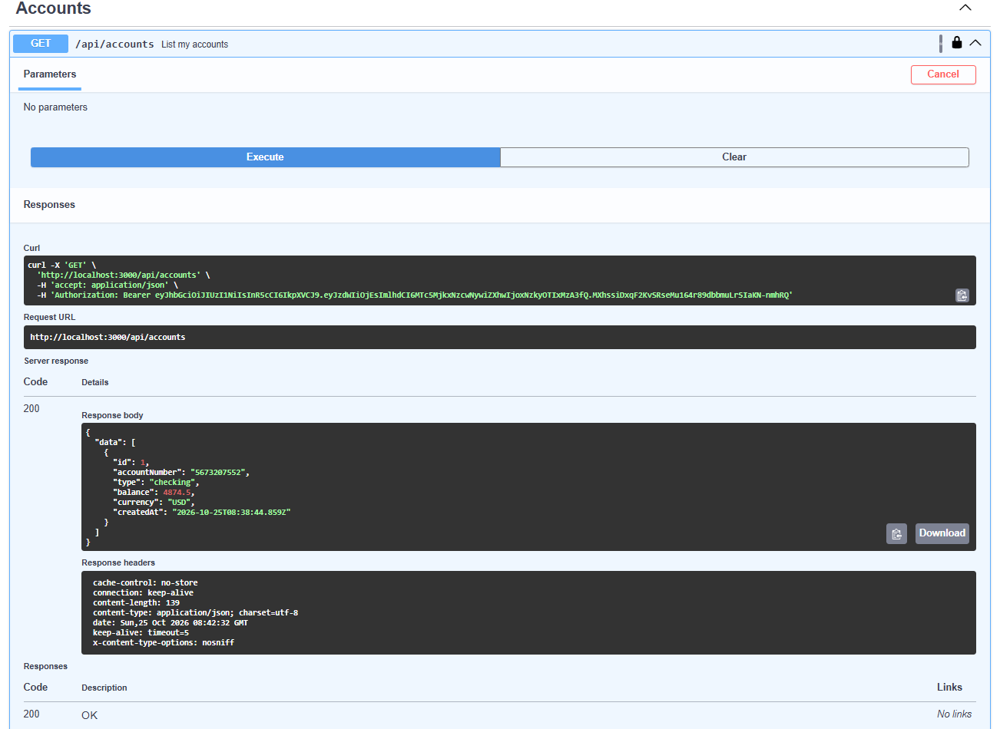
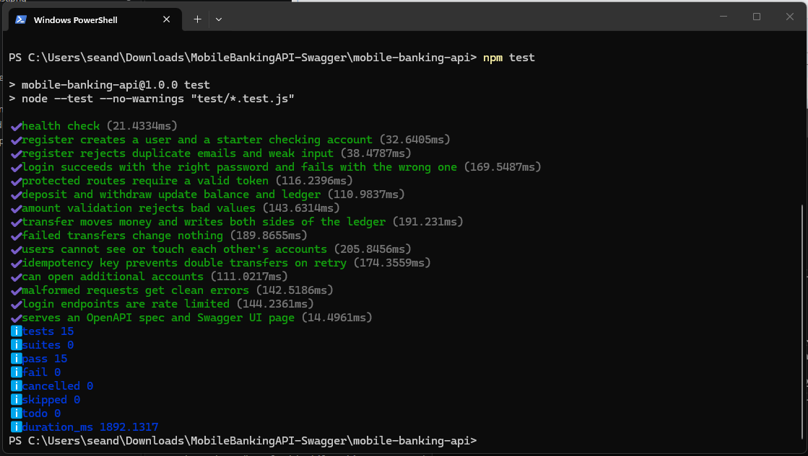

# Mobile Banking API

A REST API for a mobile banking app, built with **Node.js and zero runtime dependencies** (built-in `http`, `crypto` and `node:sqlite`). Runs locally with a single SQLite file.

> ⚠️ **Portfolio / learning project.** It is not a real bank and has not been security-audited. Don't use it with real money or real customer data.

## Features

- **Auth**: registration, login, JWT (HS256) access tokens, scrypt password hashing
- **Accounts**: every customer gets a checking account, and can open more (checking or savings)
- **Money movement**: deposits, withdrawals and account-to-account transfers
- **Transaction history** with pagination (newest first)
- **Idempotent transfers** via an `Idempotency-Key` header, so mobile clients can retry safely after a dropped connection
- Input validation, consistent JSON error format, rate-limited login/register, body size limits
- Interactive Swagger UI docs at `/docs`
- 15 integration tests using Node's built-in test runner




## Quick start

Requires **Node.js 22.13+**.

```bash
git clone https://github.com/seandefiesta/mobile-banking-api
cd mobile-banking-api
cp .env.example .env      # then set JWT_SECRET (see the comment inside)
npm run seed              # optional: demo users alice@example.com / bob@example.com (Password123)
npm start                 # http://localhost:3000
npm test
```

There is nothing to `npm install` because there are no dependencies. Use `npm run dev` for auto-restart while editing. `requests.http` has ready-made requests for the VS Code REST Client extension.

## API

All bodies are JSON. Authenticated routes need `Authorization: Bearer <accessToken>`. Amounts are plain numbers with at most 2 decimals (e.g. `25.50`).

| Method | Path | Auth | Description |
|---|---|---|---|
| GET | `/health` | no | Liveness check |
| POST | `/api/auth/register` | no | Create a customer and a starter checking account |
| POST | `/api/auth/login` | no | Returns `accessToken` |
| GET | `/api/me` | yes | Current user |
| GET | `/api/accounts` | yes | List my accounts |
| POST | `/api/accounts` | yes | Open an account `{ "type": "checking" or "savings" }` |
| GET | `/api/accounts/:id` | yes | Account details and balance |
| GET | `/api/accounts/:id/transactions?limit=&offset=` | yes | Transaction history |
| POST | `/api/accounts/:id/deposits` | yes | `{ "amount", "description?" }` |
| POST | `/api/accounts/:id/withdrawals` | yes | `{ "amount", "description?" }` |
| POST | `/api/transfers` | yes | `{ "fromAccountId", "toAccountNumber", "amount", "description?" }` (optional `Idempotency-Key` header) |

### Interactive docs (Swagger UI)

With the server running, open **http://localhost:3000/docs**. Log in via `POST /api/auth/login`, copy the `accessToken`, click **Authorize**, paste it, and you can try every endpoint from the browser. The raw spec is at `/openapi.json` (import it into Postman or Insomnia if you prefer). The Swagger UI files load from the cdnjs CDN, so your browser needs internet access.

### Example

```bash
# log in
curl -s -X POST localhost:3000/api/auth/login \
  -H 'Content-Type: application/json' \
  -d '{"email":"alice@example.com","password":"Password123"}'

# transfer money
curl -s -X POST localhost:3000/api/transfers \
  -H "Authorization: Bearer $TOKEN" \
  -H 'Idempotency-Key: 7c9e6679-7425-40de-944b-e07fc1f90ae7' \
  -H 'Content-Type: application/json' \
  -d '{"fromAccountId":1,"toAccountNumber":"7309809527","amount":100,"description":"Rent share"}'
```

### Errors

Every error uses the same shape, which is easy for a mobile client to handle:

```json
{ "error": { "code": "insufficient_funds", "message": "Insufficient funds" } }
```

Common codes: `validation_error` (422, with per-field `details`), `unauthorized` (401), `not_found` (404), `insufficient_funds` (422), `email_taken` (409), `rate_limited` (429).

## Design decisions

- **Money is stored as integer cents**, never floats. `0.1 + 0.2` can't corrupt a balance. A `CHECK (balance_cents >= 0)` constraint backs up the application-level overdraft check.
- **Transfers are atomic.** Debit, credit and both ledger rows happen in one `BEGIN IMMEDIATE` transaction, so a failure leaves nothing half-done.
- **Append-only ledger.** Each transaction row stores `balanceAfter`, and both sides of a transfer share a `reference`.
- **Idempotency keys** are stored with a hash of the request. Replaying the same request returns the original result (`200` + `Idempotent-Replayed: true`). Reusing a key with a different payload is rejected.
- **No account enumeration.** Accessing someone else's account returns `404` (not `403`), and login returns the same error and similar timing for unknown emails and wrong passwords.
- **Passwords** use scrypt with a per-user salt, compared in constant time. The JWT signature is verified with a constant-time comparison, and the algorithm is pinned to HS256.
- **Binds to `127.0.0.1` only**, so it isn't exposed to your network by default.

## Project structure

```
src/
  server.js     entry point: config, HTTP server, graceful shutdown
  app.js        request pipeline: routing, auth, rate limit, body parsing, errors
  routes.js     route table (endpoint -> handler)
  services.js   business logic (the only place that touches money)
  validate.js   input parsing and validation
  auth.js       password hashing and JWT
  db.js         SQLite schema and transaction helper
  openapi.js    OpenAPI spec + Swagger UI page
  errors.js     HttpError type
scripts/seed.js demo data
test/           integration tests
```

## Ideas for next steps

- Refresh tokens and logout / token revocation
- Swap the home-grown router for Express or Fastify
- Daily transfer limits, PINs or 2FA for transfers
- Scheduled and recurring transfers, statements (PDF/CSV export)
- Dockerfile + GitHub Actions workflow running `npm test`
- Port to PostgreSQL

## License

MIT
